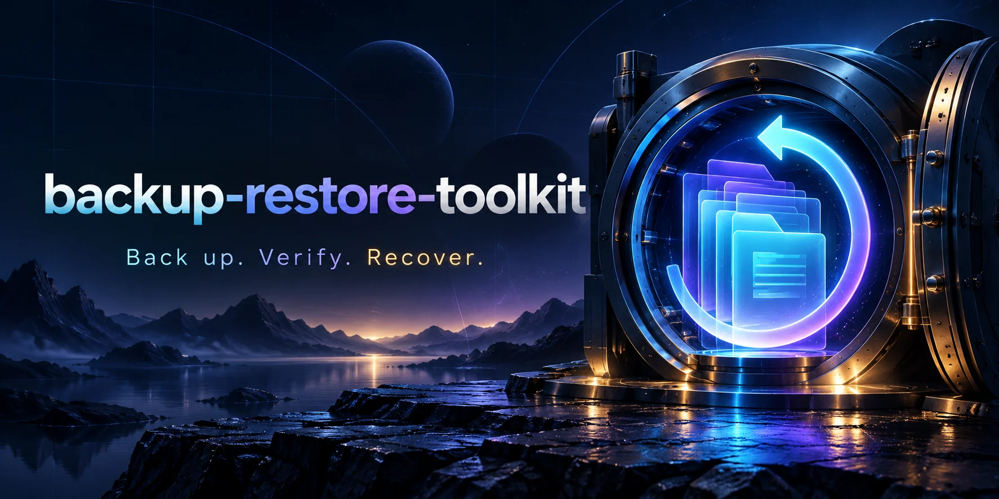

# Backup & Restore Toolkit



A small Linux file-backup CLI with SHA-256 manifests, verified archives, isolated restores, logging, and optional systemd scheduling.
## Try a complete recovery

Requires Linux and Python 3.11 or newer. No third-party Python packages are needed.

```bash
mkdir -p demo/source
printf 'A file worth keeping\n' > demo/source/notes.txt
python3 backup.py create demo/source demo/archives
```

Copy the archive path printed by the command, then use it below:

```bash
python3 backup.py verify demo/archives/BACKUP_FILENAME.tar.gz
python3 backup.py restore demo/archives/BACKUP_FILENAME.tar.gz demo/restored
diff -r demo/source demo/restored
```

The restore target must not exist. The original directory is never overwritten. `diff` should produce no output and exit successfully for this example.

## Workflow

1. Read regular files and directory names from the chosen source; skip symbolic links with a warning.
2. Write a compressed tar archive and a JSON manifest of file sizes and SHA-256 checksums.
3. Verify the completed archive before atomically publishing it under its final backup name.
4. During restore, reject unsafe paths, duplicate members, unsupported entry types, checksum mismatches, and unlisted entries.
5. Restore into a private staging directory, then rename it into a new destination only after successful verification and copying.

Backups use a timestamp plus random suffix. A failed backup removes its temporary archive and exits nonzero; a failed restore removes its staging directory. SHA-256 detects accidental corruption; it does **not** authenticate an archive against a malicious author who can also change the manifest.

## Logs and limits

```bash
python3 backup.py --log-file backup.log create ~/Documents ~/Backups
python3 backup.py verify ARCHIVE.tar.gz --max-gib 20
python3 backup.py restore ARCHIVE.tar.gz ~/RecoveredDocuments --max-gib 20
```

The default uncompressed limit is 10 GiB across archive entries, including the manifest. Creation verifies against that default, so create is limited to 10 GiB. Verify/restore allow an explicit higher limit. Archives also have a 100,000-entry limit and a 16 MiB manifest limit. These are guardrails, not a complete hostile-archive sandbox.

The CLI uses a private umask. Restored files use mode `0600` and directories `0700`; ownership, executable bits, original permissions, timestamps, extended attributes, ACLs, device nodes, and symlinks are not preserved. Back up ordinary static document trees rather than a whole operating system. No encryption, automatic deletion, retention, upload, or offsite replication is implemented. Keep archives on a trusted filesystem and use a different device for real disaster recovery.

This is not a filesystem snapshot. Concurrent edits may cause a backup failure and changes between different files are not transactionally consistent. Stop writers before backing up important data. Use database-native dump/snapshot tools for databases. Source/backup/restore parent directories must be controlled by your user; this tool is not hardened for concurrent filesystem manipulation by another local user.

## Optional daily user timer

Review and edit `systemd/portfolio-backup.service`, especially its paths. The example expects the project at `~/backup-restore-toolkit`, with `~/Documents` as source and `~/Backups` as destination. The timer runs around 19:00 in the host's local timezone, with up to 10 minutes of jitter.

```bash
mkdir -p ~/.config/systemd/user
cp systemd/portfolio-backup.* ~/.config/systemd/user/
systemctl --user daemon-reload
systemctl --user enable --now portfolio-backup.timer
systemctl --user list-timers portfolio-backup.timer
journalctl --user -u portfolio-backup.service
```

This does not install or start a timer automatically. User timers require a running user service manager; without lingering, they may not run while you are logged out. A missed persistent timer can run on next activation. Disable it with `systemctl --user disable --now portfolio-backup.timer`. Avoid overlapping manual/scheduled backups of the same live source.

## Validation

```bash
python3 -m unittest discover -s tests -v
```

Six tests cover binary/text/empty-directory recovery, overwrite protection, recursive backup prevention, symlink skipping, corrupted data rejection, path traversal rejection, and archive expansion limits. The systemd timer remains untested on a real systemd user manager.

## What this demonstrates

Recovery-oriented operations, content verification, structured archive validation, conservative filesystem writes, exit codes and logs, and systemd scheduling configuration. It is a portfolio tool, not a replacement for mature production backup software.
